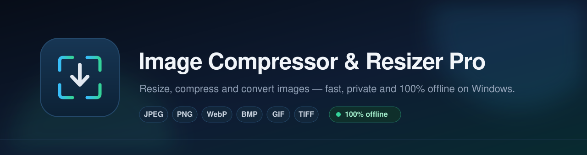
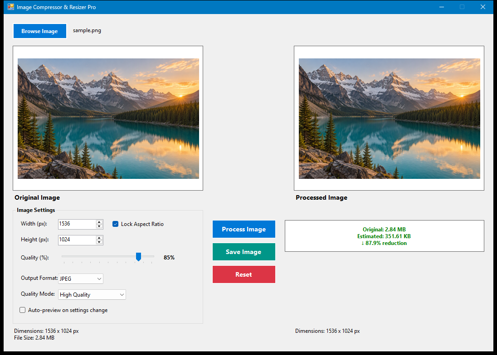

<div align="center">
  
  <br /><br />
  <a href="https://github.com/kopolart/image-compressor-pro/actions/workflows/build.yml"></a>
  <a href="https://github.com/kopolart/image-compressor-pro/releases"></a>
  
  
  <a href="LICENSE"></a>
</div>

<h1 align="center">Image Compressor &amp; Resizer Pro</h1>

<p align="center">
  A fast, private Windows desktop app to resize, compress and convert images.<br />
  See the real output size <em>before</em> you save &mdash; no uploads, no telemetry, no accounts.
</p>

<p align="center">
  
</p>

---

## Highlights

- **Live output-size estimation** &mdash; every settings change triggers a debounced background encode and reports the real encoded size, plus the percentage change versus the original.
- **Six output formats** &mdash; JPEG, PNG, WebP, BMP, GIF and TIFF, with a quality slider for JPEG and WebP.
- **True lossless WebP** at quality 100; normal lossy WebP below it.
- **Aspect-ratio lock** that keeps width and height in sync while you type.
- **EXIF-aware loading** &mdash; phone photos are rotated upright automatically.
- **Correct transparency handling** &mdash; alpha is preserved for PNG/WebP and transparent pixels are flattened to white for JPEG/BMP instead of turning black.
- **No file locks** &mdash; images are read into memory, so you can move or delete the source file while the app is open.
- **Always fresh output** &mdash; saving re-encodes from the current settings, so the file can never be stale.
- **100% offline** &mdash; the application contains no network code and no telemetry.

Example: a 1536 &times; 1024 photo at 2.84 MB becomes roughly **352 KB** at JPEG quality 85 &mdash; an **87.9% reduction** (as shown in the screenshot).

## Download

Grab the latest build from the [Releases page](https://github.com/kopolart/image-compressor-pro/releases):

1. Download `image-compressor-pro-vX.Y.Z-win-anycpu.zip`.
2. Extract it anywhere &mdash; the app is portable, no installer required.
3. Run `ImageCompression.exe`.

**Requirements:** Windows 10 (1903 or later) or Windows 11, x86 or x64. .NET Framework 4.8 is included with these Windows versions.

> The release binary is not code-signed, so Windows SmartScreen may show a warning on first launch. Choose **More info &rarr; Run anyway**, or build from source.

## Usage

1. **Browse Image** and pick a photo. The original preview, dimensions and file size appear immediately.
2. Set the **width** and **height**. *Lock Aspect Ratio* is on by default.
3. Choose the **quality** (JPEG/WebP only), **output format** and **quality mode** (interpolation).
4. Optionally enable **Auto-preview on settings change** for a debounced live preview.
5. Click **Process Image** to render the preview.
6. Click **Save Image** &mdash; the file is re-encoded from the current settings and you get the saved path and final size.

The estimation panel updates while you change settings and shows the original size, estimated size and the reduction or increase.

## Supported formats

| Format | Quality control | Transparency | Encoder |
| --- | --- | --- | --- |
| JPEG | 1&ndash;100 | Flattened to white | GDI+ |
| PNG | Lossless | Preserved | GDI+ |
| WebP | 1&ndash;100 (lossless at 100) | Preserved | ImageSharp |
| BMP | &mdash; | Flattened to white | GDI+ |
| GIF | &mdash; | Passed through | GDI+ |
| TIFF | &mdash; | Passed through | GDI+ |

Input support covers JPEG, PNG, WebP, BMP, GIF and TIFF. Files that GDI+ cannot decode are retried with ImageSharp, which is how WebP input works.

## How the size estimator works

The estimator uses the same encoding pipeline as the save action, so its numbers track the real output closely:

1. A settings change schedules one estimate after a 350 ms debounce.
2. The resized snapshot is created on the UI thread, because GDI+ bitmaps are not thread-safe.
3. The encode runs on a background task and the UI stays responsive.
4. A version counter discards stale results when a newer request has been made.

See [docs/ARCHITECTURE.md](docs/ARCHITECTURE.md) for the full design, ownership rules and threading model.

## Build from source

### Prerequisites

- Windows 10/11
- [.NET SDK 8.0 or later](https://dotnet.microsoft.com/download)
- .NET Framework 4.8 targeting pack &mdash; installed by Visual Studio 2022 (**.NET desktop development** workload) or the [Developer Pack](https://dotnet.microsoft.com/download/dotnet-framework/net48)

### Commands

```bash
git clone https://github.com/kopolart/image-compressor-pro.git
cd image-compressor-pro
dotnet build ImageCompression.sln -c Release
```

The executable is written to `ImageCompression/bin/Release/net48/ImageCompression.exe`.

To produce a distributable folder:

```bash
dotnet publish ImageCompression/ImageCompression.csproj -c Release -o dist
```

## Project structure

```text
.
├── ImageCompression/
│   ├── MainForm.cs            # UI construction and event wiring only
│   ├── Program.cs             # Entry point and global error handling
│   ├── Core/
│   │   ├── ImageLoader.cs     # Decoding, EXIF orientation, WebP fallback
│   │   ├── ImageProcessor.cs  # Resizing and alpha flattening
│   │   ├── ImageEncoder.cs    # GDI+ and ImageSharp encoding
│   │   ├── OutputFormat.cs    # Format table (single source of truth)
│   │   └── SizeEstimator.cs   # Debounced background size estimation
│   └── Properties/            # Assembly metadata and resources
├── docs/
│   ├── ARCHITECTURE.md
│   └── images/                # Banner and screenshot
└── .github/                   # CI, release automation and templates
```

## Tech stack

| Layer | Technology |
| --- | --- |
| Language | C# 7.3 |
| Runtime | .NET Framework 4.8 |
| UI | Windows Forms |
| Imaging | GDI+ / System.Drawing |
| WebP codec | [SixLabors.ImageSharp](https://github.com/SixLabors/ImageSharp) 2.1.11 (Apache-2.0) |
| CI/CD | GitHub Actions (build + tagged releases) |

## FAQ

**Does the app upload my images?** No. It has no networking code, telemetry or update checks. Everything runs locally.

**Why .NET Framework 4.8 instead of .NET 8?** It is preinstalled on supported Windows versions, so the app runs from a zip without installing a runtime.

**How accurate is the size estimate?** It runs the same encoder with the same settings as the final save. The real file can still differ by a few bytes due to metadata and headers, but the estimate is consistently close.

**Why is WebP quality 100 lossless?** At 100 the app switches ImageSharp to lossless WebP, which is useful for graphics and screenshots. Lower values produce smaller lossy files.

**Why not upgrade ImageSharp?** Version 2.1.x is the last Apache-2.0 line; 3.x moved to the Six Labors Split License. The trade-off and known advisories are documented in [SECURITY.md](SECURITY.md#dependency-advisories).

**Is there batch processing or drag-and-drop?** Not yet. Both are listed in the [changelog](CHANGELOG.md) roadmap.

## Contributing

Bug reports, feature requests and pull requests are welcome. Read
[CONTRIBUTING.md](CONTRIBUTING.md) and the [Code of Conduct](CODE_OF_CONDUCT.md)
before opening an issue or PR.

## Security

Please report vulnerabilities privately through GitHub Security Advisories.
See [SECURITY.md](SECURITY.md) for the supported versions and scope.

## License

Licensed under the [Apache License 2.0](LICENSE). See [NOTICE](NOTICE) and
[THIRD-PARTY-NOTICES.md](THIRD-PARTY-NOTICES.md) for attribution details.

## Acknowledgements

- [Six Labors](https://sixlabors.com/) for ImageSharp, which provides WebP support.
- The .NET and Windows Forms teams for the platform and tooling.
